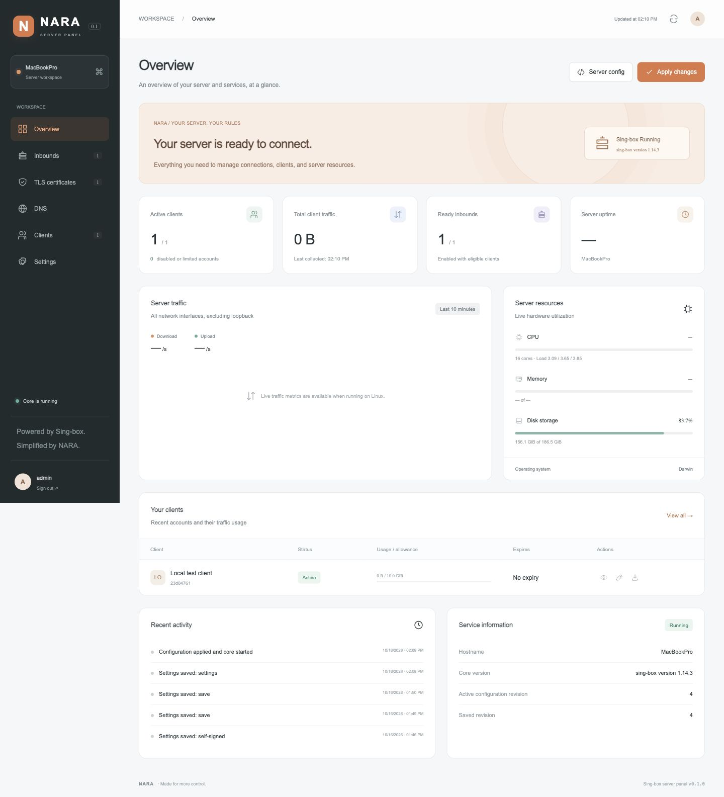
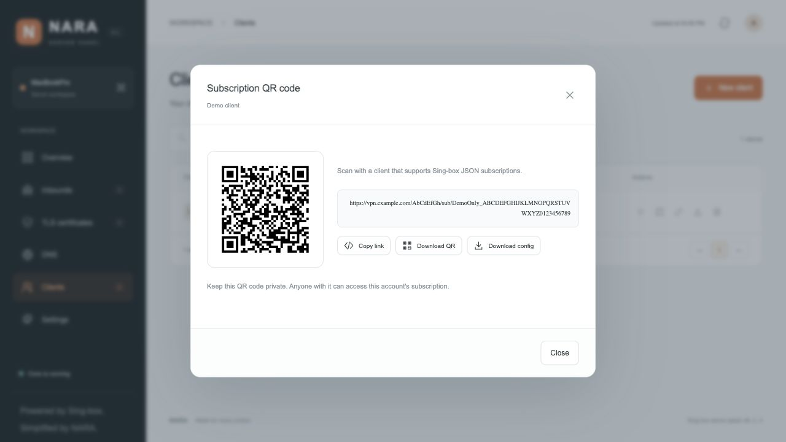

# NARA Panel

An English web panel for running **Sing-box on your own Linux server**. Inspired by the NARA OpenWrt project's orange skin, local configuration generation, and validation-before-activation workflow. This is a separate server application; it does not modify the OpenWrt project.



## Included

- **Overview:** Linux CPU, RAM, disk, load, uptime, hostname, sampled network traffic, client traffic totals, core status, and recent events. Unavailable measurements are shown as unavailable.
- **Inbounds:** VLESS, VMess, Trojan, Hysteria2, TUIC, and AnyTLS; TCP, WebSocket, and gRPC where supported; multiple authenticated clients per inbound; enable/disable and TLS assignment.
- **TLS:** import PEM certificate/key pairs, validate their match and SAN hostname, generate ECDSA self-signed certificates with one action, show expiry, and download the public certificate.
- **DNS:** UDP, TCP, TLS, HTTPS, and local resolvers; default resolver; hostname bootstrap validation; ordered domain/domain-suffix/domain-keyword/rule-set rules with route/reject actions; inline JSON and remote HTTPS source/SRS rule sets.
- **Clients:** multiple inbound assignments, generated UUID/password, enabled state, expiry, traffic allowance, durable upload/download totals, reset usage, rotate subscription links, JSON configuration download, private Sing-box JSON subscription URLs with usage headers, and locally generated subscription QR codes with PNG download.
- **Operations:** SQLite persistence, admin sign-in, password change, logout, server-side sessions, CSRF checks, sign-in throttling, core validation, managed restarts, attempted rollback after startup failure, and systemd installation.

The interface defaults to **English and left-to-right**. [راهنمای نصب فارسی](INSTALL.fa.md).

## Requirements

- Linux with systemd for direct installation; Python 3.10+, Python venv, OpenSSL 1.1.1+, and CA certificates.
- Sing-box **1.14.3**, built with **`with_quic,with_v2ray_api`**. Default official release builds do not include V2Ray API. The supplied build script pins the official source commit and uses its Go module checksums. Building requires Go 1.27.1 or a compatible newer toolchain, Git, and Internet access.
- Public server address, open inbound TCP/UDP ports, and an HTTPS reverse proxy for public panel/subscription access.

The panel owns its Sing-box child process and configuration. Give it separate ports from any existing installation. It does not edit host firewall rules, routes, system DNS, or another Sing-box service.

## One-line Linux installation

From an interactive SSH session on **Debian 12+ or Ubuntu 22.04+**, on **amd64 or arm64**, run as root:

```sh
curl -fsSL https://raw.githubusercontent.com/kevinzakarian/Nara-Panel/main/install.sh | bash
```

For an account with sudo access, replace the last `bash` with `sudo bash`.

The installer downloads the source, installs system dependencies, verifies an isolated Go toolchain against its official SHA-256, builds the pinned Sing-box source with client statistics, and creates the systemd service. Building can take several minutes. It asks for:

1. **webPath** — enter a single path segment such as `MyPanel`. Press **Enter** for a cryptographically random **8-letter path containing both uppercase and lowercase letters**, e.g. `/aBcDefGh/`.
2. **Panel port** — press **Enter** for **10000**, or enter another available port. Invalid, reserved, and occupied ports are rejected.
3. **Administrator password** — choose and confirm at least 12 characters. The username is `admin`.

The panel is then reachable at `http://YOUR_SERVER_IP:PORT/webPath/`. The final URL is printed after a readiness check; allow the selected TCP port in your firewall. No administrator password is bundled. The installer does not change firewall rules.

Entry settings are stored with mode 0600 in `/etc/nara-panel.env`. Re-running the installer offers existing path/port values as defaults and preserves accounts and data. A customized path scopes the UI, assets, API, subscription links, and session cookies; it supplements administrator authentication.

For public HTTPS, configure a reverse proxy using `deploy/Caddyfile.example`, **preserve the full webPath**, set `NARA_BIND=127.0.0.1` and `NARA_SECURE_COOKIE=1` in `/etc/nara-panel.env`, and restart the service. The proxy must forward the chosen panel port. In Settings, enter the public HTTPS URL, including the webPath; if only an origin is entered, the UI appends its current webPath to subscription links.

For a manual source installation on other systemd Linux distributions, install Python/venv, Git, a compatible Go toolchain, OpenSSL and CA certificates first, then run:

```sh
sudo sh scripts/install.sh
```

The local installer asks the same entry questions and builds a missing core. You may supply an already compatible binary with `sudo NARA_INSTALL_CORE=/path/to/sing-box sh scripts/install.sh`.

## Docker alternative

```sh
docker compose build
docker compose run --rm nara python -m nara init
docker compose up -d
```

The container runs unprivileged with a persistent named volume. Set `NARA_WEB_PATH=/YourChosenPath` in its environment if you want a prefix; container setup does not run the interactive Linux installer. Use inbound ports **1024 or above inside the container**. Update Compose port mappings for every inbound. For example, container port 8443 can be published as host port 443; set the inbound's **Public port** to 443 so exports use the correct endpoint. The example publishes TCP 8443 and UDP 8444 on the same numbered host ports; add other mappings as needed. HTTPS reverse proxy setup is separate; `NARA_SECURE_COOKIE=1` expects HTTPS. For initial HTTP tunnel access only, temporarily override it to `0`.

## Updating an installed panel

For application updates with unchanged Python dependencies, run as root:

```sh
curl -fsSL https://raw.githubusercontent.com/kevinzakarian/Nara-Panel/main/update.sh | bash
```

This updates the application and web interface using the installed Sing-box core, preserving the panel port/webPath, administrator, accounts, and saved configuration. It restarts the panel and core, verifies readiness, and attempts to restore the previous application code if startup fails. If dependencies have changed, it stops before applying code and asks you to use the full installer. Docker installations should rebuild the image instead.

Version **0.1.2** fixes Generate certificate on Python 3.12+ by replacing the removed `ssl.match_hostname` call with OpenSSL DNS/IP checking. Certificate/key matching and expiry checks remain enforced. Missing OpenSSL now produces an actionable error.

## First connection

1. In **Settings**, set the public server domain/IP and public HTTPS panel URL.
2. In **TLS certificates**, import a trusted certificate or click **Generate self-signed**.
3. In **Inbounds**, create an inbound with a unique port and attach the certificate.
4. In **Clients**, create a client, assign inbounds, and choose allowance/expiry.
5. Click **Apply changes**. The panel validates with `sing-box check`, starts the core, and verifies the traffic API. A startup failure triggers a rollback attempt.
6. In **Clients**, click **Subscription QR code** to scan or download the subscription QR as a PNG. The QR is also shown in account details alongside **Copy link** and **Download config**. Set the public panel HTTPS URL in Settings first. Client JSON exposes a loopback mixed proxy on port 2080 and a selector of assigned outbounds. It can be imported/merged into a Sing-box-compatible client.

Self-signed client exports include the public certificate as a trusted certificate; they never disable TLS verification. Public panel HTTPS and inbound TLS are configured independently.

QR codes contain the private subscription URL, including the account token and configured webPath. Encoding and PNG export happen locally in the browser with a bundled encoder; no external QR service is contacted. Scan them with a client that supports Sing-box JSON subscriptions. Rotating the subscription link produces a new QR code when reopened.



## Accounting and operational limits

- Usage is the sum of per-user uplink and downlink payload counters from the core. It is not NIC bandwidth or a billing-grade wire-byte counter. Host network graphs include unrelated host traffic.
- Usage and expiry are checked every **5 seconds**. Crossing a limit rebuilds the running configuration and restarts the whole core, disconnecting all active connections. Enforcement can overshoot within the polling/restart window. Sudden crashes/power loss can lose the most recent uncollected interval; graceful restarts collect first.
- Saved edits are drafts until **Apply changes**. The active snapshot controls existing accounts and exported configurations. Disabling/deleting an account also prevents subscription downloads immediately; removing existing network access requires applying the edit. Rotating a subscription URL does not invalidate already downloaded credentials.
- After **three consecutive failed accounting polls**, the panel stops the core. An unexpected exit is reported and requires a manual apply; no automatic crash loop is started inside the panel. A normal panel restart restores the last applied configuration if the core had not been explicitly stopped.
- No live connected-user count, online status, per-device/IP/concurrency limit, speed limit, periodic quota renewal, URI/Base64 subscription, ACME automation for inbound certificates, or REALITY/ShadowTLS/advanced transport editor is claimed in this release. Account status means eligible, not currently connected. Shadowsocks inbounds are not included.
- Imported certificates are stored and used locally. To renew a certificate, edit its TLS profile and apply. Rule-set downloads are performed by the core; failed core validation/download does not replace the active generation.
- There is one administrator identity. Private keys, client credentials, subscription tokens, and the database must stay private. Core diagnostics live in the private data directory as `core.log`; the UI does not display raw core errors that might contain credentials.
- For a consistent manual backup, stop the panel service and back up the entire `/var/lib/nara-panel` directory including the SQLite database. Restore only to a trusted host with the service stopped. Automatic encrypted backups and multi-server management are outside this release.

## Development and verification

```sh
python3 -m venv .venv
.venv/bin/python -m pip install -r requirements.txt
.venv/bin/python -m nara init
.venv/bin/python -m nara serve --binary "$PWD/dist/sing-box"
```

Open http://127.0.0.1:10000. To test a custom prefix, add `--web-path /AbCdEfGh` and visit http://127.0.0.1:10000/AbCdEfGh/. Linux `/proc` metrics remain unavailable on macOS; the panel does not fill them with demonstration values. Local previews use isolated data; the project ships without accounts or sample client credentials.

```sh
.venv/bin/python -m unittest discover -s tests -t . -v
SING_BOX_TEST_BINARY="$PWD/dist/sing-box" .venv/bin/python -m unittest discover -s tests -t . -v
node --check web/app.js
npm ci --ignore-scripts
npm test
```

Node.js/npm are only used for development QR verification; the installed panel needs neither. QR tests decode the rendered QR with an independent decoder and verify custom paths, IPv6/ports, long links, token rotation, and missing public URL behavior.

Integration tests exercise real loopback transfers for all six protocols, self-signed TLS verification, per-user accounting, persistence without double counting, quota enforcement, and rollback after a bind failure. They do not change host routes, firewall, or DNS.

Reset administrator access on an installed server:

```sh
cd /opt/nara-panel
sudo -u nara-panel .venv/bin/python -m nara reset-password --data /var/lib/nara-panel --username admin
```

## Upstream references

- [Sing-box configuration](https://sing-box.sagernet.org/configuration/)
- [V2Ray API and required build capability](https://sing-box.sagernet.org/configuration/experimental/v2ray-api/)
- [DNS server configuration](https://sing-box.sagernet.org/configuration/dns/server/)
- [Official source used for the core build](https://github.com/SagerNet/sing-box/tree/v1.14.3)

NARA Panel is independent of SagerNet. Panel code is MIT licensed. Sing-box and third-party dependencies retain their respective licenses; the core is built separately from upstream GPL-licensed source.
