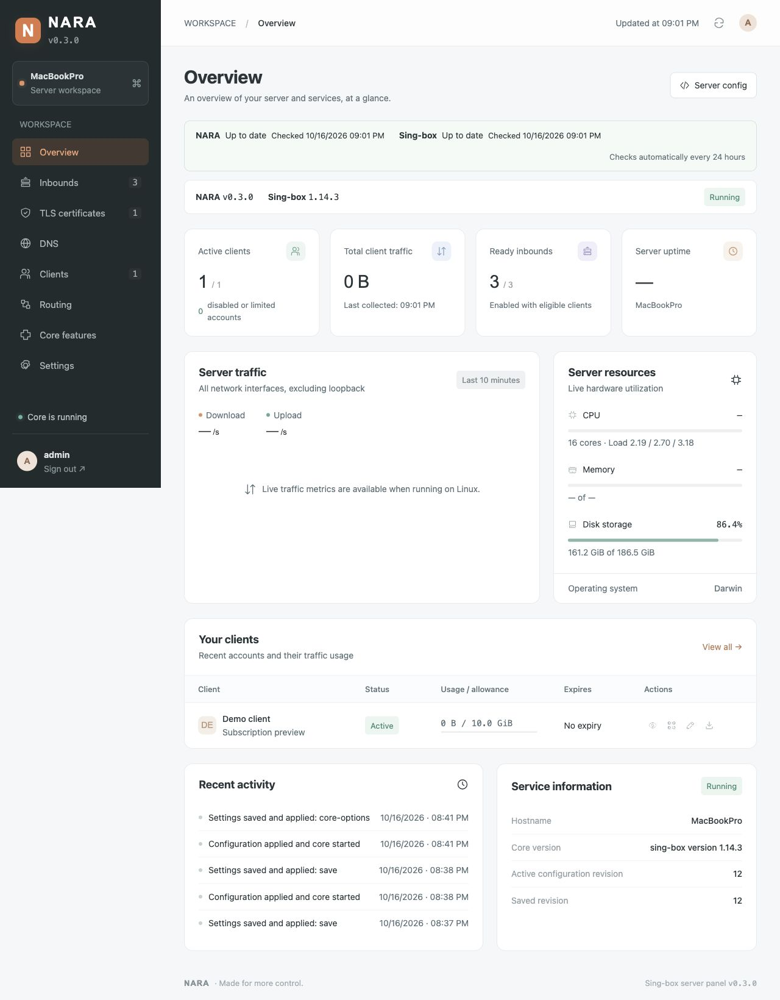
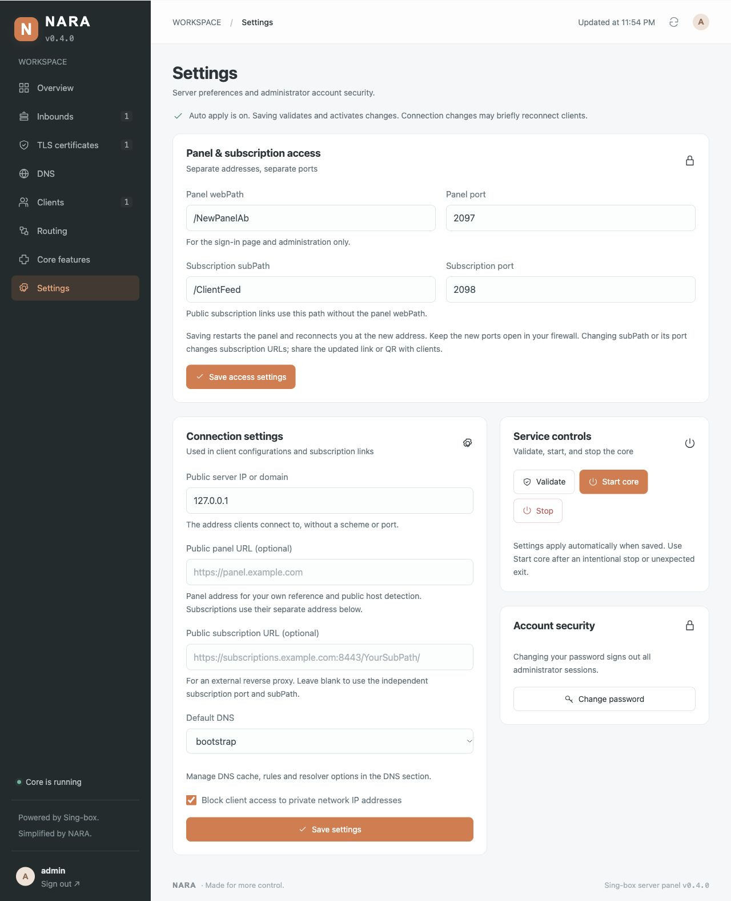
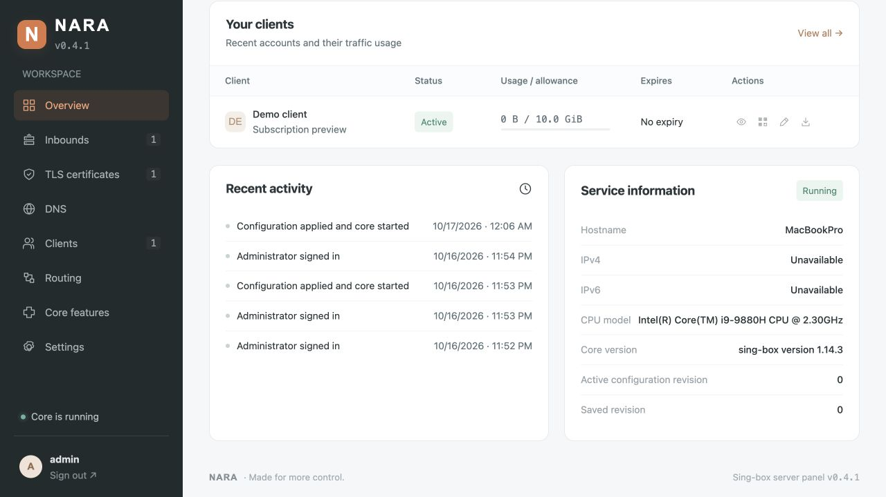
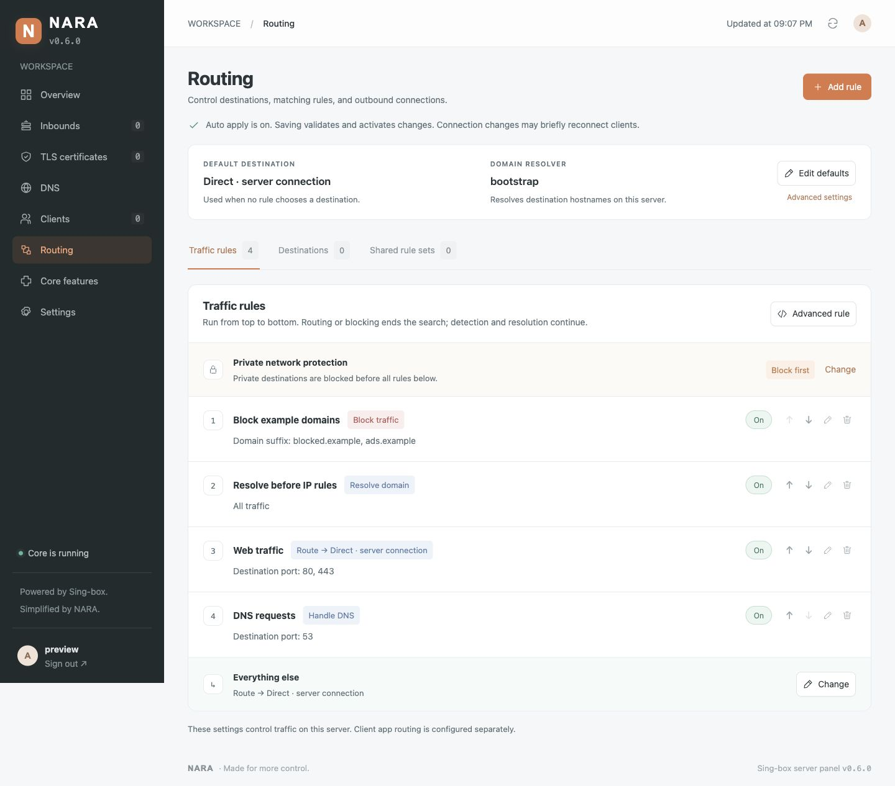
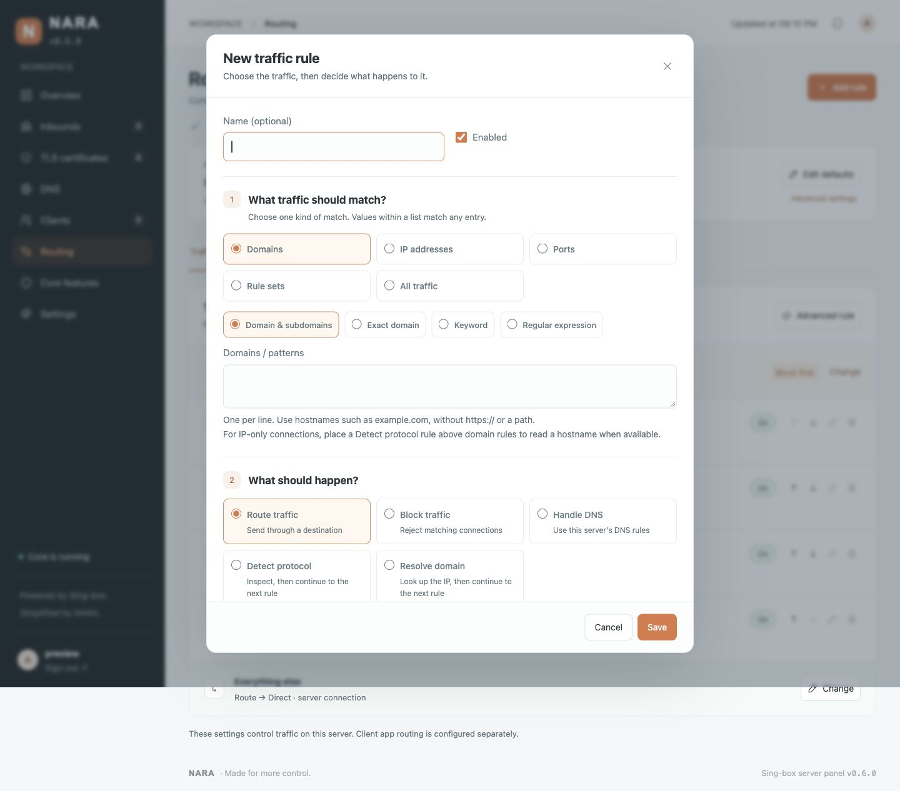
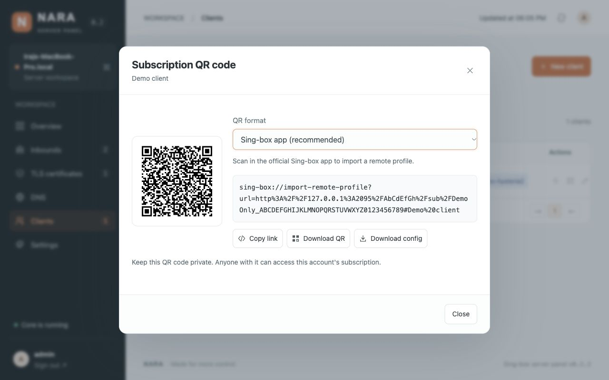

# NARA Panel

An independent English web panel for running **Sing-box on your own Linux server**. Inspired by the NARA OpenWrt project's orange skin, local configuration generation, and validation-before-activation workflow. This is a separate server application; it does not modify the OpenWrt project.



## Included

- **Overview:** Linux CPU, RAM, disk, load, uptime, hostname, assigned IPv4/IPv6 addresses, CPU model in its own labeled row, sampled network traffic, client traffic totals, core status, and recent events. Unavailable measurements are shown as unavailable.
- **Inbounds:** all 19 Sing-box 1.14.3 types, including Shadowsocks, ShadowTLS, Hysteria, Snell 5/6, Naive, HTTP/SOCKS, TUN, transparent listeners and Cloudflared. Complete versioned forms include nested protocol/TLS/transport/listen options. Existing VLESS, VMess, Trojan, Hysteria2, TUIC and AnyTLS account management remains available. Standalone listeners manage their own credentials. See the [feature review](FEATURE_REVIEW.md).
- **TLS:** import PEM certificate/key pairs, validate their match and SAN hostname, generate ECDSA self-signed certificates with one action, show expiry, and download the public certificate. Each profile has explicit client **Allow insecure**, SNI suppression, ALPN, TLS versions and handshake timeout.
- **DNS:** all 15 typed resolvers, complete logical/default rules and actions, races/speculation, predefined replies, optimistic/cache controls and local/remote/inline rule sets.
- **Routing:** guided traffic rules, readable ordered cards, one-click enable/disable and priority changes, destination groups and shared lists. All specialized 1.14.3 options remain available in advanced JSON editors.
- **Core features:** five endpoint types, ten service types, certificate providers, HTTP clients, namespaces, logging, NTP, certificate trust and experimental cache/Clash API settings.
- **Updates:** read-only checks for panel and stable upstream core releases when an authenticated browser enters the panel. Results persist across restarts; there is no daily timer or background polling schedule.
- **Clients:** multiple inbound assignments, generated UUID/password, enabled state, expiry, traffic allowance, durable upload/download totals, reset usage, rotate subscription links, JSON configuration download, private Sing-box JSON subscription URLs with usage headers, and locally generated QR codes in official Sing-box remote-profile and direct JSON URL formats, with PNG download.
- **Access settings:** separate panel webPath/port and subscription subPath/port, prompted during installation and editable together in Settings on managed Linux installs. Subscription ports serve profiles only; no login page or admin API.
- **Operations:** SQLite persistence, admin sign-in, password change, logout, server-side sessions, CSRF checks, sign-in throttling, automatic validation/application on save, managed restarts, attempted rollback after startup failure, and systemd installation. Saved and active settings are committed together; invalid changes preserve the previous settings.

The interface defaults to **English and left-to-right**, with a 16 px body/input baseline and larger readable labels and captions. [راهنمای نصب فارسی](INSTALL.fa.md).

## Requirements

- Linux with systemd for direct installation; Python 3.10+, Python venv, OpenSSL 1.1.1+, CA certificates and iproute2 for interface discovery. Minimal older Linux installs can fall back to `hostname -I`.
- Sing-box **1.14.3** with upstream standard capabilities plus `with_v2ray_api`. The installer downloads a prebuilt NARA-compatible core for Linux amd64/arm64. **Go, Git and a compiler are not required on the server.** Default SagerNet binaries omit the accounting capability, so the NARA builds are published separately with upstream notices and source.
- Public server address and open inbound TCP/UDP ports. Panel and subscription URLs support HTTP and HTTPS. The server manager can set up a dedicated HTTPS reverse proxy, or you can use an existing one.

The panel owns its Sing-box child process and configuration. Give it separate ports from any existing installation. The installer leaves host firewall, routes, DNS and other Sing-box services untouched. Native TUN/transparent/network-namespace features can change networking when you explicitly configure them and provide the required capabilities; see [host requirements](FEATURE_REVIEW.md#builds-and-host-requirements).

## One-line Linux installation

From an interactive SSH session on **Debian 12+ or Ubuntu 22.04+**, on **amd64 or arm64**, run as root:

```sh
curl -fsSL https://raw.githubusercontent.com/kevinzakarian/Nara-Panel/main/install.sh | bash
```

For an account with sudo access, replace the last `bash` with `sudo bash`.

The launcher **first refreshes apt package lists and upgrades installed system packages**, keeping existing package configuration files when a decision is required. This can restart system services. It does not run a distribution release upgrade, remove packages automatically or reboot the server; a pending-reboot notice appears in the menu. It then opens the English **NARA server manager**. Package-update errors stop preparation with an error rather than being reported as success.

Choose **1 — New installation** for a new server or to reinstall retained data. For an existing installation, choose **2 — Upgrade panel only** (keep its current core) or **3 — Upgrade panel + download compatible core**. Option 3 retrieves the pinned compatible binary; it does not build on the server. The existing service keeps running until download, checksum, architecture and capability checks pass.

For an older installed `sudo nara` command, use the fresh one-line launcher above or upgrade the panel first; an old manager still contains its old build procedure.

The compatible core is built and tested on native **amd64 and arm64 GitHub Actions runners**, then published in [NARA core releases](https://github.com/kevinzakarian/Nara-Panel/releases). Each archive contains the core, matching Cronet library, upstream licenses and build provenance. `core-release.json` pins each archive's SHA-256 in the panel source, so verification does not rely solely on a checksum downloaded alongside the binary. The downloader checks the complete archive, ELF architecture, payload hashes and pinned build metadata before publishing staged files.

Downloads use HTTPS with retries and bounded timeouts. An unavailable artifact, incorrect checksum or unsupported architecture stops installation **without falling back to compilation**. The server never downloads Go or module dependencies. The source build script remains available for maintainers and CI only. Old caches from earlier releases are not needed by this installer.

Every question has a bold cyan **[INPUT]** marker, with the default in brackets. Password prompts explain that typing is hidden. `NO_COLOR` or a plain terminal disables ANSI colors while preserving the markers. A new installation asks for:

1. **webPath** — enter a single path segment such as `MyPanel`. Press **Enter** for a cryptographically random **8-letter path containing both uppercase and lowercase letters**, e.g. `/aBcDefGh/`.
2. **Panel port** — press **Enter** for **10000**, or enter another available port. Invalid, reserved, and occupied ports are rejected.
3. **subPath** — a different subscription path. Press **Enter** for another mixed-case random **8-letter path**.
4. **Subscription port** — press **Enter** for **10001** (10002 if the panel uses 10001). It must differ from panel and statistics ports and saved inbound listeners.
5. **Administrator username** — choose 1–64 letters, numbers, dots, underscores, `@` or hyphens. Press Enter for `admin`.
6. **Administrator password** — choose and confirm at least 12 characters.

The panel is then reachable at `http://YOUR_SERVER_IP:PANEL_PORT/webPath/`; profiles use `http://YOUR_SERVER_IP:SUB_PORT/subPath/TOKEN`. After readiness and subscription checks, the terminal displays the panel URL in cyan, username in green and newly chosen password in yellow, followed by the subscription address. The password is displayed only on the controlling terminal; its private temporary handoff is deleted. Upgrades preserve the existing username/password and display Unchanged rather than a password hash. `NO_COLOR` retains readable plain text. Allow both selected TCP ports in your firewall. No administrator password is bundled. The installer does not change firewall rules.

Entry settings are stored with mode 0600 in `/etc/nara-panel.env`. Menu upgrades preserve existing entry values, administrator, accounts and data. The first upgrade from 0.3.1 or earlier asks for the new subscription path/port; later upgrades keep them. Existing managed HTTPS also asks for its separate public subscription port when first migrated. Failed full upgrades attempt to restore the previous application, virtual environment, core, service and entry settings; a private data backup is created before menu upgrades. The panel webPath scopes the UI, assets, administration API and session cookies. Subscriptions use their own subPath and listener. Paths supplement administrator authentication.

For public HTTPS, use **4 — Panel HTTPS / Certificate** in the manager (see below). For your own reverse proxy, preserve the full webPath and subPath in **two separately exposed ports**, forward each to its matching backend, set `NARA_BIND=127.0.0.1` and `NARA_SECURE_COOKIE=1`, and restart the service. Public panel URL is optional and is used for panel reference/hostname detection. Public subscription URL is a separate optional override for an external proxy; include its actual port and subPath. Without it, links use the browser/public hostname, independent subscription port and subPath, including on HTTP. A local SSH tunnel requires a public hostname reachable by clients.

In **Settings → Panel & subscription access**, change all four entry values and click **Save access settings**. The installed root broker accepts only these validated fields, checks ports, restarts the service and attempts rollback if readiness fails. The browser reconnects to the new panel address; changing webPath can require signing in again. Under managed HTTPS, these port fields refer to **public HTTPS ports**; backend ports stay separate and on loopback. Open the new ports yourself. An external reverse proxy or Docker port mapping must be updated outside the panel; its listener/mapping is not managed by this broker.

**Subscription URLs change when subPath or its port changes, including the first 0.4.0 upgrade. Share the new link/QR and replace the remote-profile address in clients. Old `/webPath/sub/TOKEN` links stop working. Account credentials, quotas and usage remain intact.**



For a manual source installation on other systemd Linux distributions on amd64/arm64, install Python/venv, curl, OpenSSL, CA certificates and iproute2 first, then run:

```sh
sudo sh scripts/install.sh
```

The local installer asks the same entry questions and downloads the same verified prebuilt core. You may supply an already compatible binary with `sudo NARA_INSTALL_CORE=/path/to/sing-box sh scripts/install.sh`.

## Installed server manager

After installing or upgrading to 0.5.1, run:

```sh
sudo nara
```

It performs the same initial system-package update, then offers:

| Option | Action |
| --- | --- |
| 1 | New installation / reinstall retained data |
| 2 | Upgrade panel only, preserving the installed core |
| 3 | Upgrade panel and download the pinned compatible core |
| 4 | Panel HTTPS: automatic domain certificate, self-signed domain/IP certificate, PEM import, certificate status |
| 5 | Service status, versions and entry URL |
| 6 / 7 / 8 | Restart / stop / start panel service; stopping also stops its core |
| 9 | Recent panel and dedicated HTTPS service logs |
| 10 | Create a private account/settings/certificate backup |
| 11 | Change administrator password and invalidate admin sessions |
| 12 | Uninstall application while keeping data, or delete its data/settings/certificates |
| 0 | Exit |

Start/restart follows the core’s saved start/stop state. Reinstalling retained data also recreates the dedicated HTTPS service; if its saved certificate cannot be verified, the manager reports that it needs repair through option 4.

Uninstall requires typing an exact confirmation. From 0.4.2, optional services absent on an older installation are skipped quietly; real inspection/disable/stop errors still abort removal before application files are deleted. Both removal modes retain pre-existing backup archives, system packages and service users. They do not remove other Sing-box installations or another web server's configuration. Backups are mode 0600 in `/var/backups/nara-panel` (directory 0700), contain credentials/private keys, and are never uploaded. SQLite's online backup includes committed WAL data; runtime generations and logs are regenerated instead of archived. To restore a NARA-created data backup manually, stop `nara-panel` and `nara-panel-https`, restore the archive's `etc/` and `var/` contents to their original paths with ownership preserved, then reinstall/upgrade through the menu and start the services. App binaries and Python packages are reinstalled, not stored in the data archive.

### Panel HTTPS certificates

The manager uses Caddy from the distribution's apt repositories and its own `nara-panel-https.service`, `/etc/nara-panel/https/` and `/var/lib/nara-panel-https/`. It does not overwrite `/etc/caddy/Caddyfile` or an existing Caddy/Nginx/Apache service. The manager asks for public panel/subscription HTTPS ports, defaulting to **443 / 8443**. These must be different, available, and separate from internal panel/subscription/statistics ports and TCP 80. **TCP 80 must also be free** for certificate challenges and redirects. If those ports are already in use, use your existing reverse proxy. UDP 443 remains available for QUIC proxy inbounds. Firewall rules are not changed automatically.

- **Automatic domain certificate:** first point every A/AAAA record to this server and allow inbound TCP 80 and both selected HTTPS ports. Caddy obtains a trusted certificate and renews it automatically while the dedicated service runs. The domain is shared with public certificate authorities/transparency logs, as expected for public certificates. See [Caddy's requirements and renewal behavior](https://caddyserver.com/docs/automatic-https).
- **Self-signed domain/IP:** creates an ECDSA certificate with the correct SAN, valid for one year. Devices must explicitly trust its public certificate. The manager does not disable verification or install a local CA into the server trust store. Regenerate before expiry.
- **Import PEM:** reads local absolute paths to a full-chain certificate and matching unencrypted private key, validates hostname/IP, key pairing and expiry, then copies them into the protected HTTPS generation. Re-import after renewal; external source files are not watched.

The proxy exposes two sites with their own public ports and preserves the complete webPath/subPath. Setup binds both internal listeners to `127.0.0.1`, enables Secure cookies and verifies both HTTPS endpoints with SNI/hostname validation. Only after verification does it update both public URLs. Failure restores the previous entry settings and managed proxy. Panel HTTPS is independent of the certificates attached to Sing-box inbounds.

## Docker alternative

```sh
docker compose build
docker compose run --rm nara python -m nara init
docker compose up -d
```

The container runs unprivileged with a persistent named volume. Set `NARA_WEB_PATH=/YourPanelPath`, `NARA_SUB_PATH=/YourSubscriptionPath`, and distinct `NARA_PORT`/`NARA_SUB_PORT` values in its environment; publish both ports through your proxy. GUI entry controls are disabled for container/manual services; container setup does not run the interactive Linux installer. Use inbound ports **1024 or above inside the container**. Update Compose port mappings for every inbound. For example, container port 8443 can be published as host port 443; set the inbound's **Public port** to 443 so exports use the correct endpoint. The example publishes TCP 8443 and UDP 8444 on the same numbered host ports; add other mappings as needed. HTTPS reverse proxy setup is separate; `NARA_SECURE_COOKIE=1` expects HTTPS. For initial HTTP tunnel access only, temporarily override it to `0`.

## Updating an installed panel

For application updates with unchanged Python dependencies, run as root:

```sh
curl -fsSL https://raw.githubusercontent.com/kevinzakarian/Nara-Panel/main/update.sh | bash
```

This updates the application and web interface using the installed Sing-box core, preserving the panel port/webPath, administrator, accounts, and saved configuration. It restarts the panel and core, verifies readiness, and attempts to restore the previous application code if startup fails. If dependencies have changed, it stops before applying code and asks you to use the full installer. Docker installations should rebuild the image instead.

Version **0.6.5** brings Resolver type into the provider box and Display name into the main DNS form. DNS Advanced sections and JSON view are removed; existing specialized settings are preserved while editing visible fields. A live resolver address shows the protocol-specific URL/endpoint, while Server, Port, Path and TLS names retain the separate fields required by the core.

Version **0.6.4** adds DNS provider templates with protocol choices for Google, Cloudflare, Quad9, AdGuard, OpenDNS and personal NextDNS profiles. Custom retains every resolver type. Version checks now run only on authenticated panel entry; the daily timer and 24-hour Overview line are removed.

Version **0.6.3** reorganizes DNS resolver forms around fixed essential fields. Tag, resolver type, Server and Server Port stay visible, with editable protocol defaults and validation. HTTPS path, hostname resolver and TLS settings appear where applicable. Advanced settings use explicit controls rather than Add option dropdowns; all 15 resolver types, stored TLS trust and custom settings remain supported.

Version **0.6.2** makes IP-address DNS resolvers independent. Unused Domain Resolver references from older forms are removed automatically, including on upgrade, so they do not block deleting an otherwise unused bootstrap resolver. Hostname-based DNS still needs a separate resolver. TLS SNI and certificate verification options are preserved.

Version **0.6.1** adds native app mode/System HTTP Proxy controls to exported profiles and connects client DNS to the panel’s current Default DNS and DNS rules. Refresh existing remote profiles once after upgrading, then reconnect. Future resolver changes use the same profile; server restarts may require a reconnect and cached answers follow their TTL.

Version **0.6.0** reorganizes Routing around traffic flow: defaults, ordered traffic rules, destinations and shared rule sets. Common rules use flat match/action/scope forms instead of nested option menus. Existing specialized rules open in a lossless advanced JSON editor. Moving rules in either direction and toggling them validates and applies immediately.

Version **0.5.2** removes surrounding whitespace/newlines from DNS addresses before validation, storage and generation. Core forms read current displayed values before saving or changing structure, including browser autofill without an input event. DNS errors identify the affected resolver. A hostname still requires a separate bootstrap; plain IP resolvers do not.

Version **0.5.1** supplies a visible bootstrap resolver for new DNS forms, checks hostname/URL/port input with actionable errors, asks for an administrator username and displays colored access details after successful installation. Password resets preserve the current username unless `--username` is provided.

Version **0.5.0** removes server-side Go/compiler requirements. Core releases are built and tested in GitHub Actions for amd64 and arm64, with checksums pinned in the source. Installation and full upgrades download the prepared core; Docker builds use it too.

Version **0.4.0** adds independent subscription entry points, four-field entry settings, automatic AnyTLS padding defaults, an unselected protocol chooser and a simpler sidebar. Upgrading from earlier versions asks for missing subscription settings. Existing compatible 1.14.3 cores can be retained with manager option 2.

Version **0.3.0** adds the complete 1.14.3 configuration workspace, routing, full DNS forms and daily release checks. Existing data is migrated without removing accounts or settings. The app-only updater keeps your current core binary. **For the complete compatible core, open the one-line manager above and choose option 3**, which downloads it and preserves your accounts and entry settings. Docker users should rebuild.

Version **0.3.1** adds the interactive server manager, highlighted terminal input, system-package preparation, protected backups/removal and panel HTTPS setup. The short app-only `update.sh` command remains available; it does not perform the system-package upgrade or open the menu.

The panel reports available core updates; core upgrades use the installation manager. Panel updates can be installed explicitly with the one-click control on managed Linux installations. Forms target 1.14.3. Review compatibility before independently moving the core to another version.

## Server information

Overview → Service information lists **IPv4**, **IPv6** and **CPU model** in separate label/value rows. Addresses come from the server's active interfaces, refreshed every minute, with duplicates, loopback, link-local and unusable addresses removed. Globally routable addresses appear first; private addresses are also listed. This does not discover an external NAT address through a public lookup service. CPU identification uses `/proc/cpuinfo`, with `lscpu` model fallback for ARM hosts. A missing address family shows **Not assigned**; failed discovery shows **Unavailable**. The macOS development preview can show unavailable Linux interface data without inventing values.



## Complete core configuration

In **Inbounds**, use **New inbound** for the existing panel-managed protocols. AnyTLS starts with the official nine-line padding scheme; keep it unless you need a custom scheme. Choosing another type opens its standalone editor; **Standalone inbound** exposes every type directly. Standalone listeners do not use panel client quotas, expiry, traffic totals or subscriptions. Their users/keys are configured in the listener itself.

Use **Add option** within any object to add a field, including nested TLS/QUIC settings, arrays and maps. Version/action selectors switch the appropriate schema. The JSON view can load and review an entire record. Private keys are hidden in general state responses and retained when omitted during editing. Save checks references, rejects outbound cycles, validates with the core and applies automatically.

**DNS** contains all resolver types, DNS rules, shared rule sets and global DNS settings. **Routing** contains Traffic rules, Destinations and Shared rule sets, with default destination/resolver controls visible above them. **Core features** contains endpoints, services, certificate providers, HTTP clients, namespaces and the remaining root settings. See the [coverage and requirements table](FEATURE_REVIEW.md) for details.

### Routing workflow

1. Check **Default destination**. Unmatched traffic leaves through this destination; **Edit defaults** also selects the domain resolver without replacing specialized route settings.
2. Under **Destinations**, add an upstream connection if needed. The built-in Direct destination connects from this server. Selector and URLTest groups use existing members; endpoints are managed in Core features.
3. Choose **Add rule**. Select domains, IPs, ports, a shared list, or all traffic; select a routing/blocking/DNS/detection/resolution action; optionally limit the inbound and network. Lists match any entry, while scope groups are combined with AND. Ports accept comma/newline-separated values and ranges such as `8000-9000`.
4. Review the actual matches and action on each rule card. Use ↑ / ↓ to change priority, or On / Off to enable/disable. A final catch-all warns when later rules cannot run. Detection and resolution continue to subsequent rules. For domain matches on IP-only requests, place a Detect protocol rule earlier when a hostname can be sniffed.
5. **Managed client DNS** shows the panel resolver used by client profiles. Its authenticated DNS service runs before traffic rules. Review **Private network protection** above the list: its block rule runs before user rules while enabled in Settings. **Everything else** shows the final fallback below the list.

**Shared rule sets** accepts remote lists, local files or inline headless rules; DNS can reuse the same lists. Adding a list alone does not route traffic. Specialized match combinations, logical groups, transports, HTTP clients and other core options remain in **Advanced JSON**; existing advanced records open there without flattening or dropping fields. Invalid changes keep the previous saved and active configuration. These are server-side traffic rules, separate from client-app routing; managed client DNS requests use this server’s DNS policy.





The routing model follows the official [route options](https://sing-box.sagernet.org/configuration/route/), [matching logic](https://sing-box.sagernet.org/configuration/route/rule/) and [rule actions](https://sing-box.sagernet.org/configuration/route/rule_action/); validation uses the bundled 1.14.3 schema and installed core.

Each authenticated panel entry starts a one-shot version check using fixed public GitHub endpoints. Opening the panel with an existing session also checks again; concurrent entries share a check already in progress. Login does not wait for GitHub, dashboard refreshes only read cached results, and no scheduled check runs while the panel is closed. Results persist across restarts. Failed checks show “Update check unavailable”; they do not mean the installed version is current.


## First connection

1. In **Settings**, set the public server domain/IP. Public panel URL is optional and accepts HTTP or HTTPS.
2. In **TLS certificates**, import a trusted certificate or click **Generate self-signed**.
3. In **Inbounds**, create an inbound with a unique port and attach the certificate.
4. In **Clients**, create a client, assign inbounds, and choose allowance/expiry.
5. Every **Save** automatically validates and activates the configuration using the installed core. There is no separate Apply step. Failed validation preserves the working core and previous settings; a startup failure triggers a rollback attempt. Connection changes can briefly disconnect clients.
6. In **Clients**, click **Subscription QR code** to scan or download the subscription QR as a PNG. The QR is also shown in account details alongside **Copy link** and **Download config**. When the public subscription URL is blank, the detected public/browser hostname and independent subscription port/subPath are used automatically. Client JSON includes an IPv4/IPv6 TUN for VPN mode in the official Sing-box apps, a loopback mixed proxy on port 2080, and a selector of assigned outbounds. The app manages the VPN interface and requests any required operating-system permission.

**After updating from 0.2.2 or earlier, refresh the remote profile in the Sing-box app before reconnecting.** Previously downloaded/local JSON files must be downloaded and imported again. Changing the panel does not update an already imported local file.

Client DNS in Rule/Global mode is forwarded through the selected authenticated proxy to the panel’s Default DNS and DNS rules. A narrowly scoped built-in rule handles this service before private-network protection; it does not open a public DNS port. The client JSON uses the internal destination `198.18.0.1:53`, not a hardcoded public provider. Resolver credentials, local file paths and server-only options stay on the server. The device resolver bootstraps only proxy-server hostnames and serves ordinary DNS in Direct mode.

Native app profiles include **Rule / Global / Direct** modes, a selector of assigned servers, persistent mode/selection state and **System HTTP Proxy** pointing to the loopback mixed listener. Rule sends local private destinations directly and other traffic through the selected proxy; Global also sends private destinations through the server, subject to server routing policies; Direct bypasses the proxy and uses device DNS. DNS interception runs before mode routing. The export does not expose a Clash REST controller port. The official app may apply its own UI/override preferences.

Client logs use info level to expose startup and connection errors. Generated VPN profiles require a Sing-box graphical app or a core with TUN support and the necessary system privileges; command-line proxy-only use must remove the TUN inbound.

By default, self-signed client exports include the public certificate as a trusted certificate. Selecting **Allow insecure (client)** explicitly disables certificate verification in that profile’s client exports; it is disabled by default and never added to the server TLS configuration. Public panel HTTPS and inbound TLS are configured independently.

QR codes contain the private subscription URL, including the account token and subPath. If you access the panel through a local tunnel, set the optional Public subscription URL to its independent address reachable by your clients. Encoding and PNG export happen locally in the browser with a bundled encoder; no external QR service is contacted. **Sing-box app (recommended)** is the default and encodes the [official remote-profile import URI](https://sing-box.sagernet.org/clients/general/#remote), including the account name. Choose **JSON subscription URL** for clients that accept a direct full Sing-box JSON URL, or for manually adding a remote profile. Copy link and Download QR follow the selected format. This does not provide Clash YAML or protocol-link/Base64 subscriptions. Rotating the subscription link produces a new QR code when reopened.



## Accounting and operational limits

- Usage is the sum of per-user uplink and downlink payload counters from the core. It is not NIC bandwidth or a billing-grade wire-byte counter. Host network graphs include unrelated host traffic.
- Usage and expiry are checked every **5 seconds**. Crossing a limit rebuilds the running configuration and restarts the whole core, disconnecting all active connections. Enforcement can overshoot within the polling/restart window. Sudden crashes/power loss can lose the most recent uncollected interval; graceful restarts collect first.
- Form edits take effect when **Save** succeeds. Account enable/disable, deletion, quota/expiry edits, usage resets, TLS changes and DNS changes apply automatically. Equivalent server configurations, client-only settings and token rotations avoid unnecessary core restarts. A successful usage reset reactivates an otherwise eligible exhausted account. Rotating a subscription URL does not invalidate already downloaded credentials.
- After **three consecutive failed accounting polls**, the panel stops the core. An unexpected exit is reported and requires **Start core** or a successful settings save; no automatic crash loop is started inside the panel. A normal panel restart restores the last applied configuration if the core had not been explicitly stopped.
- Panel-managed accounts have no live connected-user count, online indicator, per-device/IP/concurrency limit, per-client speed cap or periodic quota renewal. Standalone protocol settings can have additional upstream controls, but they are not panel account limits. Account status means eligible, not currently connected. Protocol-link/Base64 subscriptions remain outside this release.
- Imported certificate profiles are stored and used locally. Renew them by editing their TLS profile, or configure an upstream certificate provider through the full core editor when appropriate. Rule-set downloads are performed by the core; failed core validation/download does not replace the active generation.
- There is one administrator identity. Private keys, client credentials, subscription tokens, and the database must stay private. Core diagnostics live in the private data directory as `core.log`; the UI does not display raw core errors that might contain credentials.
- For a consistent manual backup, stop the panel service and back up the entire `/var/lib/nara-panel` directory including the SQLite database. Restore only to a trusted host with the service stopped. Automatic encrypted backups and multi-server management are outside this release.

DNS resolvers using a hostname need a separate **Domain Resolver** (bootstrap), as described in the [upstream HTTPS DNS documentation](https://sing-box.sagernet.org/configuration/dns/server/https/). IP-address resolvers are independent and new forms do not preselect a Domain Resolver. Unused Domain Resolver fields on IP-address servers are removed automatically from saved/active models and core configuration; this includes references populated by older versions. Hostname-based servers retain their explicit dependencies and cycle protection. The TLS Server Name / SNI can remain a hostname when Server is an IP. Enter an IP/hostname in **Server**, put the port in **Server Port** and the DoH path in **Path**. Invalid input is rejected before changing saved or active settings.

## Core build and release maintenance

[The core workflow](.github/workflows/core-release.yml) is dispatched manually after reviewing `core-build.json`. It builds the exact pinned upstream commit on two native Linux runners, runs real traffic/accounting and auto-apply integrations, then publishes both archives together under a new core release tag. A published core tag is never overwritten. Review the workflow output, pin both archive digests in `core-release.json`, then publish the panel update. Run [the Go-free verification workflow](.github/workflows/verify-prebuilt.yml) against the pinned public assets before publishing the installer. It downloads and exercises the actual release in minimal Python containers with neither Go nor Git installed. Panel-only changes reuse the existing core release.

For local maintainer builds, `scripts/build-core.sh` needs a compatible Go toolchain, Git and Python. It preserves upstream tags/linker flags, adds accounting support, validates Go module checksums and packages the matching library. This script is not invoked by either server installation path. Source and original upstream notices accompany the binary release; these are NARA compatibility builds, not official SagerNet binary releases.

## Development and verification

```sh
python3 -m venv .venv
.venv/bin/python -m pip install -r requirements.txt
.venv/bin/python -m nara init
.venv/bin/python -m nara serve --binary "$PWD/dist/sing-box"
```

Open http://127.0.0.1:10000. Subscriptions use http://127.0.0.1:10001/subscriptions/TOKEN by default. Change them with `--sub-port` and `--sub-path`. To test a custom prefix, add `--web-path /AbCdEfGh` and visit http://127.0.0.1:10000/AbCdEfGh/. Linux `/proc` metrics remain unavailable on macOS; the panel does not fill them with demonstration values. Local previews use isolated data; the project ships without accounts or sample client credentials.

```sh
.venv/bin/python -m unittest discover -s tests -t . -v
SING_BOX_TEST_BINARY="$PWD/dist/sing-box" .venv/bin/python -m unittest discover -s tests -t . -v
node --check web/app.js
npm ci --ignore-scripts
npm test
```

Node.js/npm are only used for development QR verification; the installed panel needs neither. QR tests decode the rendered QR with an independent decoder and verify custom paths, IPv6/ports, long links, token rotation, missing public URL behavior, the official import URI with Unicode profile names, format switching, and matching copy/PNG payloads.

Integration tests exercise real loopback transfers for all six protocols, Vision, VMess padding/multiplex, Salamander/Gecko, TUIC congestion settings, AnyTLS padding and every supported V2Ray transport. They also cover automatic HTTP saves, failed-save rollback, usage reset atomicity, inactive inbound checking, DNS options, self-signed TLS verification, accounting, persistence and quota enforcement. They do not change host routes, firewall, or DNS.

Reset administrator access on an installed server:

```sh
cd /opt/nara-panel
sudo -u nara-panel .venv/bin/python -m nara reset-password --data /var/lib/nara-panel
```

## Upstream references

- [Sing-box configuration](https://sing-box.sagernet.org/configuration/)
- [V2Ray API and required build capability](https://sing-box.sagernet.org/configuration/experimental/v2ray-api/)
- [DNS server configuration](https://sing-box.sagernet.org/configuration/dns/server/)
- [Official source used for the core build](https://github.com/SagerNet/sing-box/tree/v1.14.3)

NARA Panel is independent of SagerNet. Panel code is MIT licensed. Sing-box and third-party dependencies retain their respective licenses; the core is built separately from upstream GPL-licensed source.

## Bundled reference data

The versioned schema and configuration help are under `nara/schema`. Their source,
regeneration command and upstream documentation license are recorded there. The
panel's own code retains its project license; the bundled QR encoder retains its
MIT notice. The build script downloads the pinned upstream core and its separately
licensed runtime dependencies from their official sources.


Client controls follow the [official TUN HTTP proxy fields](https://sing-box.sagernet.org/configuration/inbound/tun/#platformhttp_proxy), [Clash mode behavior](https://sing-box.sagernet.org/configuration/experimental/clash-api/#default_mode), and the 1.14.3 core’s [mode-list calculation](https://github.com/SagerNet/sing-box/blob/v1.14.3/experimental/clashmode/mode_list.go). Native-app button visibility also depends on the app’s UI preferences. System HTTP Proxy is a separate control from starting/stopping the VPN.


Version **0.6.6** places DNS Display name beside Tag, removes the resolver enable checkbox and shows a compact automatic TLS summary for provider presets. Encrypted DNS still uses TLS; Custom resolvers keep editable server name and certificate verification. Existing hidden TLS trust settings and disabled resolver states are preserved. TLS certificates now use a table, and the footer groups NARA, its version and tagline.

**One-click panel updates:** Linux installations managed by NARA show **Update panel** in Overview and **Panel updates** in Settings when a newer stable GitHub release is found on entry (the main branch alone does not announce an update). No SSH username or password is stored. The existing root maintenance broker accepts only a stable version number, downloads the source asset and SHA256SUMS from this fixed public repository, verifies the checksum and version, creates a private backup, and runs the updater with readiness checks and rollback on failure. The panel briefly restarts; the installed Sing-box core is preserved. Private update logs are in `/var/log/nara-panel-update.log`. A checksum validates downloaded bytes; repository release access remains the trust boundary.

Existing installations must upgrade once with the command below (or installation manager option 2) to install the new maintenance helper. Later stable releases can use the button. Releases that change Python dependencies require the full installation manager; Docker/manual installations keep their own update process.

```sh
curl -fsSL https://raw.githubusercontent.com/kevinzakarian/Nara-Panel/main/update.sh | sudo bash
```


Version **0.6.7** adds Family Safe presets for AdGuard DNS, Cloudflare, CleanBrowsing and OpenDNS FamilyShield. Provider choices are alphabetical, with **Custom / Manual** last. New resolver forms default to Cloudflare over HTTPS and fill Display name from the provider. Automatic names follow provider changes; custom names and existing resolver configurations are preserved. CleanBrowsing uses its specific HTTPS path and a separate TLS hostname. OpenDNS FamilyShield offers UDP, TCP and HTTPS; no unsupported QUIC option is offered.

Family endpoint references: [Cloudflare Families](https://developers.cloudflare.com/1.1.1.1/setup/), [AdGuard Family Protection](https://adguard-dns.io/kb/general/dns-providers/#family-protection), [CleanBrowsing network requirements](https://cleanbrowsing.org/support/troubleshooting/firewall-dns-requirements), [OpenDNS FamilyShield](https://www.opendns.com/setupguide/) and [Cisco FamilyShield guide](https://www.cisco.com/c/en/us/support/docs/security/umbrella/225803-understand-opendns-familyshield.html). The dedicated FamilyShield HTTPS address was also verified through public DNS and an HTTPS resolver query.


Version **0.6.8** fixes panel-update backups on hosts where `runuser` cannot change user identity inside the maintenance service. The database snapshot uses the existing direct owner-worker mechanism, clears supplementary groups and drops to the database UID/GID before reading the live SQLite WAL. It does not invoke PAM or open the live database as root. Backup failures stop installation and write details to the private `/var/log/nara-panel-update.log` before returning a short message to the panel.

If an installed 0.6.6/0.6.7 updater is blocked by this error, use the command-line updater once to install the fix; the currently installed updater cannot complete its backup to install its own repair. Do not disable backups or change database permissions to work around it.

The service regression reproduced an effective/permitted capability set missing `CAP_SETUID`, even though it remained in the bounding set. The root maintenance unit now explicitly retains `CAP_SETUID` and `CAP_SETGID` through `AmbientCapabilities`, as described in [systemd's capability settings](https://www.freedesktop.org/software/systemd/man/latest/systemd.exec.html#AmbientCapabilities=). NoNewPrivileges and filesystem/kernel protections stay enabled. The regression also requires the database child to have the owner's UID/GID and zero permitted/effective/ambient capabilities after switching identity.

## DNS policies and Cloudflare WARP — 0.7.0

The DNS sidebar badge counts resolvers. **DNS → DNS rules** now shows ordered, readable match/action cards with on/off switches, movement in either direction, and an explicit default resolver. The guided form supports domain matches, shared rule sets, query types, inbound/transport scope, resolver selection, blocking, custom DNS records and query options. Empty match lists are rejected. A catch-all terminal rule warns when it shadows later rules. Existing logical rules, response evaluation and specialized fields remain editable without losing their configuration. These semantics follow the [Sing-box DNS rule actions](https://sing-box.sagernet.org/configuration/dns/rule_action/).

To create a WARP destination, open **Routing → Destinations → Create WARP**, read and accept Cloudflare’s consumer terms, then create it. The server generates a WireGuard key pair using the installed core and registers the public key with Cloudflare. The private key stays in the private panel database and generated core configuration; state responses redact it. Registration tokens and license details are not retained. No Go, new Python package, Cloudflare CLI, system tunnel or additional privileges are required.

After creation, use the endpoint card’s **Use in a traffic rule** action, enter the desired domains/list/ports and save. You can also choose its `warp` destination tag (or `warp-2`, etc.) in an existing traffic rule or group. Creation does not change your default route or DNS resolver. For DNS queries through WARP, choose its tag in a resolver’s **Detour** field, then use that resolver in a DNS rule or as the default. Deleting a referenced destination fails validation and retains the working configuration.

WARP uses a [user-space Sing-box WireGuard endpoint](https://sing-box.sagernet.org/configuration/endpoint/wireguard/) with IPv4/IPv6 addresses, returned peer key and reserved client ID, MTU 1280 and keepalive. This is the free consumer WireGuard service, not WARP+ or a managed Zero Trust/MASQUE deployment. The registration contract is based on the [wgcf implementation](https://github.com/ViRb3/wgcf/blob/master/cloudflare/api.go); **Cloudflare does not document this consumer interface as a supported public registration API**. Registration may be denied or rate-limited on some servers. NARA reports the failure, keeps existing settings, makes no automatic repeated registrations and does not bypass Cloudflare challenges. Existing WireGuard credentials can instead be configured under **Core features → Endpoints**. A successful create means registered and applied, not that external connectivity has been measured. Removing the panel endpoint removes its local configuration; it does not close the remote Cloudflare account.

If registration succeeds but a concurrent edit or core validation prevents apply, its configuration is kept privately for retry. Refresh the panel and repeat creation to reuse that registration. The product requires explicit terms acceptance before registration; automated verification mocks Cloudflare and never accepts terms or creates public accounts.
